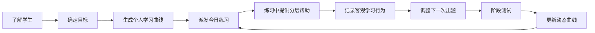

# 九字方法论：一页读懂

## 产品核心

> 一对一、练中学、帮你学

这九个字不是宣传语，而是系统的三层结构。

| 方法 | 一句话理解 | 系统如何实现 |
| --- | --- | --- |
| 一对一 | 先了解这个学生，再决定他今天学什么 | 初始画像、学科能力、目标、静态曲线、行为记录、阶段测试和动态调整共同决定个人学习路径 |
| 练中学 | 不是先听完课再练，而是在可重复的实践中形成理解 | 直接做题，错了重做，再换一个数字、换两个数字、换情境或增加步骤，直到能独立完成 |
| 帮你学 | 不代替思考，而是在卡住时只给恰好需要的帮助 | 累积式分层提示、历史原题回忆、分步引导和多种解法都来自同一套可验证解题结构 |

## 三条系统主线

### 一对一的配置

1. **起点不同**：基本信息、两层性格支持测试和学科能力测试形成初始状态。
2. **终点不同**：学生可以独立确定目标，家长或老师可以提出建议，但成人不是必经节点。
3. **节奏不同**：总学习周期、每日时间、每周频率与系统统计共同形成静态学习曲线。
4. **每天不同**：昨天的错误、提示、重做、速度、迁移和自愿加练决定明天的题目组合。
5. **曲线有纪律**：每日练习只影响后续出题，只有正式测试能够更新动态学习曲线。

### 练中学的配置

1. 每个知识点先进入问题，不要求学生先读完一段教学文字。
2. 错题首先原题重做，随后换一个数字、换两个数字。
3. 三个层次都能无提示完成后，再进入下一个知识点或更复杂步骤。
4. 当天完成后可以自愿看对错详情、同类型题、难一点的题或知识图鉴。
5. 每一次选择都是行为证据，但不会变成对学生公开的负面标签。

### 帮你学的配置

1. 提示按“读题翻译 -> 找关系 -> 组织步骤 -> 计算与检查”逐层展开。
2. 后一层提示出现时，前面的提示仍然保留。
3. 学生做过类似题时，可以先看原题和自己的答案，尝试回忆，而不是马上看解法。
4. 分步引导要求学生一步一步作答，训练正确的问题解决流程。
5. 同一题可以展示代数、图示、算术或有边界的逻辑尝试等不同路径。

## 为什么这不是普通题库

系统的核心资产不是大量静态题目，而是：

1. **题型逻辑库**：每个题型定义变量、边界、关系、答案、步骤、提示、标签和变式。
2. **用户行为数据库**：记录可信的学习表现和交互选择。
3. **个性化匹配引擎**：把学生状态、曲线和题型逻辑连接起来。
4. **验证门**：任何题目都必须通过答案、语义、年级、步骤和元数据验证后才能交付。

## 当前一句话结论

当前半 AI 版已经把九字方法论做成真实的前后台学习闭环；下一阶段的重点不是重做系统，而是完成上海 G1-G6 数学内容覆盖、教研审核和生产级云端能力。
