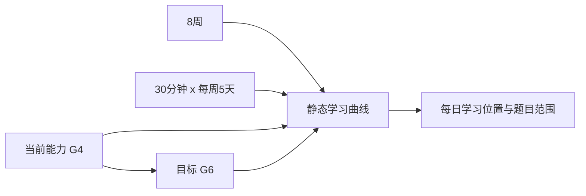

# 九字方法论：一个学生的完整实例

下面用一个虚构学生“小安”说明系统如何把九字方法论变成可执行过程。示例数字用于解释系统，不代表真实学生结论。

## 1. 一对一：先知道他是谁，再决定他做什么

### 1.1 初次进入

小安自己注册学生账号。他没有老师，也暂时没有家长账号，系统仍允许他独立完成全部流程。

系统依次收集：

- 标准化基本信息
- 6 道心理支持情境题
- 6 道学习方式情境题
- 学生主动选择的数学科目
- 不带提示的初始数学能力题

性格部分不是医学诊断，也不把“纪律差”“容易放弃”等标签告诉学生。它只生成后台的支持起点，例如：题目分块要不要更小、提示入口要不要更明显、反馈语气如何、是否保留探索空间。

### 1.2 目标与静态曲线

初始测试显示小安当前主要处于 G4 学习位置，他选择目标 G6，并选择：

- 总周期：8 周
- 每日学习：30 分钟
- 每周学习：5 天

后台把当前能力、目标差距、可投入时间和既有统计模型组合成一条向上的静态曲线。它不是一句“努力就能达到”的承诺，而是每日任务分配的第一版基线。



### 1.3 每日一对一不是只调难度

第一天没有历史数据，系统依据初始能力和曲线出题。第二天开始，系统读取小安前一天的可信记录：

- 哪些题答错
- 哪些题用了几层提示
- 重做是否成功
- 同结构换数字后是否仍会
- 换了情境是否还能识别关系
- 作答是否异常快且多次错误
- 是否主动加练或打开知识图鉴

这些记录改变下一次题目组合，而不是简单地给小安贴一个“强”或“弱”的标签。

## 2. 练中学：错误不是终点，而是练习序列的开始

### 2.1 原题

题目：图书角有 38 本故事书，又放入一些后共有 65 本。放入了多少本？

核心关系：

```text
原有数量 + 新增数量 = 总数量
38 + x = 65
x = 65 - 38 = 27
```

小安第一次回答 23，系统判定错误，但不立刻展示完整讲解。

### 2.2 原题重做

系统先要求小安重新做同一道题。这样可以区分粗心、误触与真正不理解。

如果小安需要帮助，可以逐层打开提示。提示是累积的：

1. **读题翻译**：找出“原来有多少、后来增加多少、最后共有多少”。
2. **找关系**：原有数量 + 新增数量 = 总数量。
3. **列式**：38 + x = 65。
4. **计算与检查**：用 65 - 38 求未知数，再把结果放回原关系检查。

小安在提示后答对。这说明他能够跟随支持完成，但还不能证明已经独立掌握。

### 2.3 换一个数字

系统在同一关系和年级边界内生成：

> 图书角原有 38 本故事书，增加后共有 68 本。增加了多少本？

这里只改变一个数字。小安无提示答出 30。

### 2.4 换两个数字

系统继续生成：

> 图书角原有 41 本故事书，增加后共有 73 本。增加了多少本？

两个数字改变，但关系不变。小安无提示答出 32。

原题、换一个数字、换两个数字都能独立完成后，系统才允许这一练习单元进入下一知识点或更深变式。这就是“做错再重来是不死之躯”的系统化表达。

### 2.5 换情境验证理解

后来系统把图书改成公交车人数，并改变问题表述。若小安仍能找出同一关系，说明他掌握的不只是题面记忆，而是结构迁移。

## 3. 帮你学：给支架，不替学生走路

### 3.1 先唤回自己的记忆

如果新题与小安以前做过的题相似，系统先提示“你以前遇到过这种关系”。小安可以打开以前的原题和自己的答案，自行回忆；只有仍然卡住时，才打开提示。

### 3.2 分步引导模式

小安也可以进入分步引导：

1. 选择已知量和未知量。
2. 选择它们之间的关系。
3. 写出或选择算式。
4. 完成计算。
5. 把结果放回题意检查。

系统只保存安全的步骤类别和完成状态，不保存学生自由书写的隐私内容作为评分依据。

### 3.3 多种方法

同一道题可以有不同的可验证方法：

- 用方程表示未知量
- 画线段图表示整体和部分
- 用逆运算直接计算

学生选择哪种方法会帮助系统以后调整方法展示顺序，但不会因为一次选择就固定他的“学习类型”。

## 4. 行为如何真正进入下一天

小安当天产生了以下证据：

| 证据 | 系统解释边界 | 下一次可能动作 |
| --- | --- | --- |
| 原题第一次错误 | 说明这次没有完成 | 优先安排原题重做 |
| 提示后正确 | 有支持时能完成 | 保留帮助入口，不直接判定掌握 |
| 一个数字变式正确 | 初步稳定 | 继续两个数字变式 |
| 两个数字变式正确 | 同关系迁移较稳定 | 可以进入下一知识点或情境迁移 |
| 多次极快错误 | 可能存在低投入作答 | 只作为低置信信号，重复出现后才调整任务块 |
| 主动加练 | 有继续探索意愿 | 可保留少量自愿挑战，不占未来日历任务 |

默认出题比例由可解释规则产生，再根据证据量逐步调整。一次异常不会大幅改变路径，所有比例有上下界和单日变化限制。

## 5. 曲线为什么不会每天乱跳

每日练习可以非常个性化，但不能每天把水平曲线改来改去。系统规定：

- **日常练习**：影响下一次出题，不改变动态曲线。
- **阶段测试**：在无提示、覆盖多个题型的条件下形成可比证据，才更新动态曲线。

练习三天后系统可以建议测试；学生可以暂时跳过，但家长或老师可设置最晚必须完成的间隔。若没有成人账号，系统使用安全默认间隔。

如果测试显示小安领先于静态曲线，系统给出三个清楚选项：

1. 目标不变，预计更早达到。
2. 学习时间不变，预计终点水平提高。
3. 调整每日时间或每周频率，生成新的动态曲线。

无人主动修改时，默认保持学习周期不变，让终点水平自然变化。

## 6. 三种角色看到同一事实的不同表达

### 学生

看到学习曲线、知识地图点亮、练习完成、温和的同类参照、测试历史和下一步。看不到后台性格标签、风险判断或算法比例。

### 家长

看到完成节奏、学习时长、提示使用、独立正确率、重做成功、阶段测试和支持建议。家长不是学生继续学习的必要审批者。

### 老师

看到与家长相同的客观基础，并增加题型、知识点和干预证据。老师同样是可选观察者，不是系统必经角色。

## 7. 一个实例背后的技术资产

这一个简单题目背后同时调用：

1. 年级与课程标签
2. 知识点和前置关系
3. 题型核心关系
4. 变量与答案边界
5. 原题、数字变式、情境迁移和步骤扩展
6. 可验证解题链
7. 累积分层提示和分步引导
8. 学生当前曲线位置
9. 最近可信行为证据
10. 权限、隐私和报告展示边界

因此，九字方法论不是某一页 UI，而是贯穿数据、算法、题目、权限和报告的系统结构。

## 8. 研究基础与我们的取舍

- 重复提取比单纯重复阅读更有助于长期保持，这支持系统以作答、重做和迁移为核心，而不是把“学过”当作“会了”。参见 [Karpicke & Roediger, Science, 2008](https://doi.org/10.1126/science.1152408)。
- K-12 辅导实验的系统综述显示，辅导整体具有显著正向效果，但频率、年级和实施方式会影响结果。这支持高频、短时、个体化路径，同时提醒我们必须做真实试点。参见 [Nickow, Oreopoulos & Quan, 2024](https://doi.org/10.3102/00028312231208687)。
- 最新的大规模 AI 数学辅导实验提示，AI 的价值依赖于把错误转化为结构化学习，而不是让学生绕开努力。这与本系统“先作答、错后支持、独立迁移”的边界一致。参见 [NBER Working Paper 35621, 2026](https://www.nber.org/papers/w35621)。
- 适应性难度本身未必自动带来更好学习结果，因此本系统不只调难度，还同时跟踪关系理解、提示依赖、重做和迁移证据。参见 [2026 early-primary adaptive ITS field experiment](https://www.sciencedirect.com/science/article/pii/S2666557326000911)。

这些研究是设计依据，不等于当前产品已经证明同样效果。教育效果必须通过后续真实、合规的对照试点验证。
