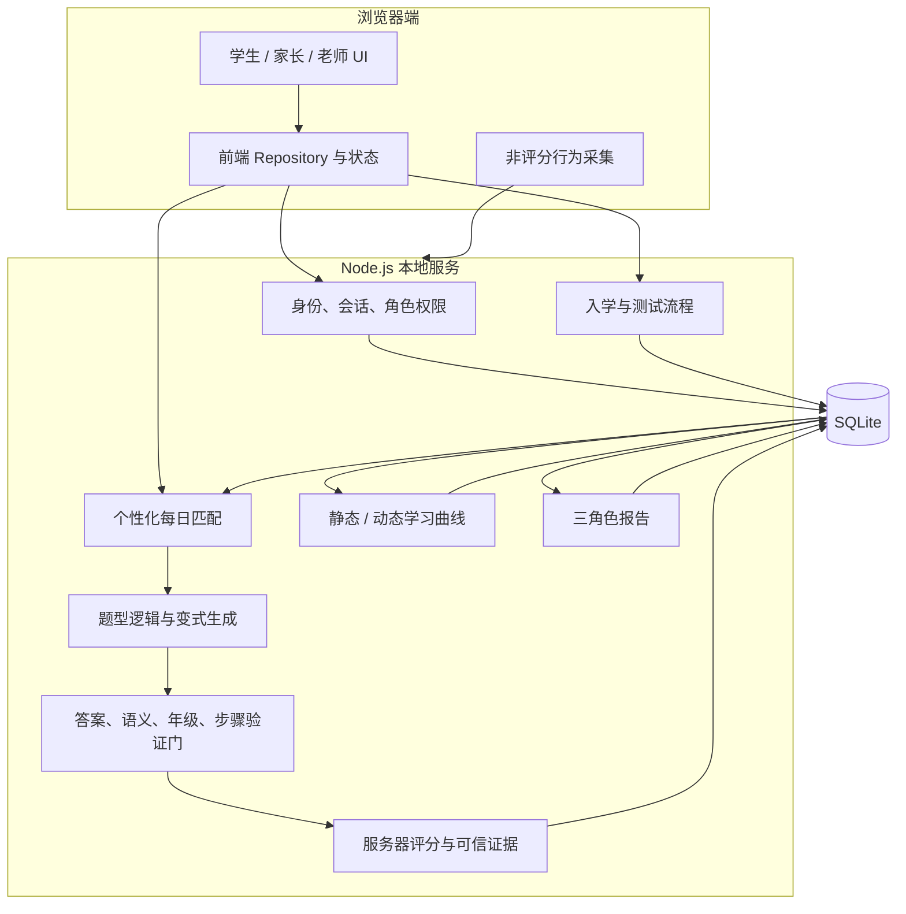
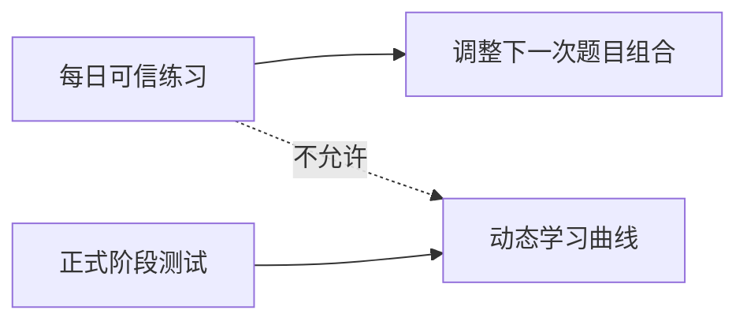
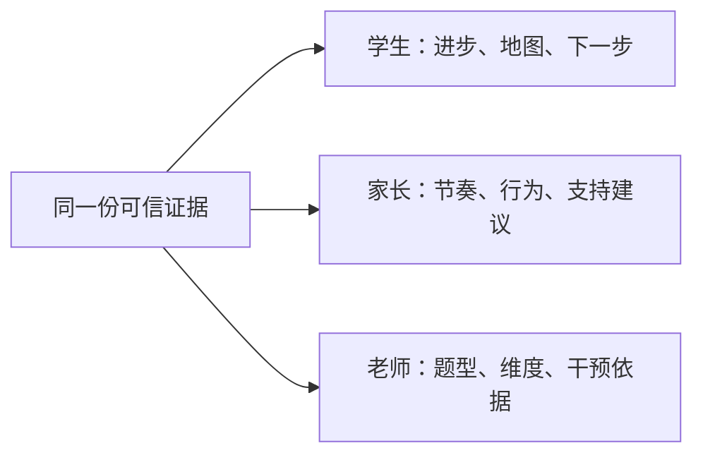

# 技术架构与数据流

## 1. 当前系统性质

当前交付是一个单机可运行、前后台分离职责明确的 Web 系统：

- 浏览器负责界面、非评分交互和短时离线兜底。
- Node.js HTTP 服务负责身份、权限、题目交付、评分、测试、曲线、报告和静态文件。
- SQLite 负责账号、关系、计划、题目交付、行为、测试、报告基础数据的持久化。
- 题型逻辑库负责在边界内生成题目，不依赖浏览器保存答案。

系统没有使用第三方运行时包。当前只依赖 Node.js 24 标准库，其中数据库使用 `node:sqlite`。

## 2. 总体结构



## 3. 关键边界

### 3.1 浏览器不是评分权威

浏览器永远不提交“我答对了”作为可信事实。它只提交学生输入、题目交付编号和有限交互信息。服务器取回私有答案规则，完成标准化、评分和记录。

学生响应中不会返回：

- 正确答案
- 生成种子
- 未打开的提示内容
- 私有解题证明
- 用户行为分类结论
- 下一日题目比例算法

### 3.2 每日适应与曲线更新分开



这条边界防止短期状态、猜测或某一天表现让长期学习曲线剧烈波动。

### 3.3 成人角色是可选关系

学生拥有自己的完整流程。家长和老师通过一次性关系邀请码获得指定学生的观察权限。任何成人只能访问已经建立有效关系的学生，不能搜索或读取其他学生。

## 4. 主要模块

| 层 | 目录 | 职责 |
| --- | --- | --- |
| 页面入口 | 根目录 HTML | 登录、学生端、观察端、账号管理、演示和状态页 |
| UI 模块 | `src/modules/` | 首页、测试、练习、提示、图鉴、报告、设置等视图 |
| 客户端服务 | `src/services/` | API 访问、状态仓库、曲线、报告展示模型和离线兜底 |
| 课程数据 | `src/data/` | 数学题型、知识图谱、入学标准选项和报告配置 |
| 服务器 | `server/local-api-server.mjs` | HTTP API、鉴权、业务路由和静态资源 |
| 数据库 | `server/database.mjs` | SQLite 表、读写方法、密码哈希、会话和种子数据 |
| 业务服务 | `server/*-service.mjs` | 测试、练习、报告、同类参照、图鉴和引导 |
| 自动验证 | `server/*-contract.mjs` | 96 项合同测试和跨模块边界测试 |
| 全流程测试 | `server/system-journey-e2e.mjs` | 五名学生及成人角色的持久化端到端测试 |

## 5. 核心技术资产

### 5.1 题型逻辑库

当前有 41 个 G1-G6 数学题型逻辑，覆盖八个领域。每个题型不是一道题，而是一个可执行模型：

```text
题型关系
+ 适用年级
+ 变量槽位
+ 数值边界
+ 情境模板
+ 答案规则
+ 解题推导
+ 提示层
+ 分步引导
+ 变式边界
+ 元数据标签
+ 语义验证
= 可安全交付的题目族
```

### 5.2 用户行为数据库

行为层区分两种证据：

- **服务器可信证据**：答案、正确性、提示深度、重做结果、变式结果、测试结果。
- **浏览器有限证据**：页面访问、可选内容打开、活动时间等非评分信息。

行为被用于下一次题目和成人支持建议，但不会直接改变正式曲线，也不会直接向学生显示后台判断。

### 5.3 个性化匹配引擎

每日匹配读取：

- 当前有效曲线位置
- 当前教学年级
- 最近可信作答窗口
- 错题与已解决状态
- 独立完成与提示后完成
- 原题、一个数字、两个数字和情境迁移
- 任务节奏、疲劳和自愿加练
- 私有支持策略

引擎先按规则计算题目桶比例，再执行置信度门、上下界、单日平滑和年级约束。结果保存在服务器每日计划中，所有入口读取同一计划。

### 5.4 验证门

半 AI 和未来全 AI 都必须通过同一验证门：

1. 题型存在且适用于目标年级。
2. 数值满足变量和答案边界。
3. 题面语义与声明关系一致。
4. 答案规则能够独立重算。
5. 解题步骤与答案推导一致。
6. 题型、知识点、能力、难度和证据标签完整。
7. 变式没有越过当前允许层级。

验证失败的候选题不会交付给学生。

## 6. 数据模型概览

| 数据表 | 用途 |
| --- | --- |
| `user_accounts` | 用户身份、角色、密码哈希和状态 |
| `auth_sessions` | 会话令牌哈希与过期状态 |
| `student_profiles` | 学生基础身份和年级 |
| `student_access_links` | 学生、家长、老师关系权限 |
| `student_relationship_invites` | 一次性关系邀请码 |
| `student_onboarding_prefills` | 基本信息、科目建议和学生确认 |
| `assessment_sessions` | 性格、初始能力和阶段测试 |
| `student_learning_goal_drafts` | 成人建议与学生确认的目标参数 |
| `student_plans` | 静态曲线、动态曲线、支持策略和当前计划 |
| `daily_practice_plans` | 某学生某日唯一的题目匹配计划 |
| `daily_practice_runs` | 每日必做练习执行状态 |
| `question_deliveries` | 私有题目候选、公开展示和评分状态 |
| `behavior_events` | 可信作答及有限交互证据 |
| `student_messages` | 家长或老师给学生的留言 |
| `observer_workspaces` | 家长与老师各自的报告模块配置 |

详细字段和隐私边界见 `reference/data-model.md` 与 `reference/role-permissions.md`。

## 7. 报告数据流

学生、家长和老师不是读取三份模拟数据，而是从同一学生证据生成不同深度的响应：



同类参照只在达到最小匿名样本后出现。当前测试阈值为五名同目标且具有可信证据的学生，生产阈值必须根据隐私评估和统计稳定性重新提高。

## 8. 当前工程限制

- 单进程、单机 SQLite，只适合开发、演示和小规模封闭试验。
- 没有生产环境的组织租户、学校层级、负载均衡、缓存、队列和可观测性。
- 没有外部身份、短信、邮件、支付和客服系统。
- 全 AI 候选接口只保留服务器适配边界，尚未连接生产模型。
- 数学逻辑已有广度，但没有完成上海教材逐章教研认证。

这些限制被明确保留在架构中，没有用界面假装已经完成。
