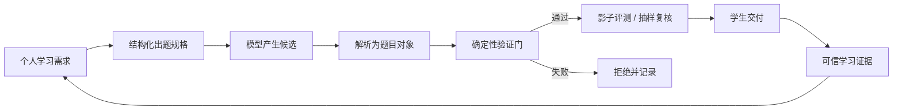

# 半 AI 边界与全 AI 路线

## 1. 结论先行

当前版本应称为 **半 AI 版（Semi-AI）**：它已经实现了真实的一对一决策、规则化出题、动态证据记录和分层帮助，但题目候选仍来自人工定义并由程序执行的题型逻辑库，尚未让生成式模型实时创造全新题型、解题步骤和支持语言。

这不是一条将来需要推翻的临时路线。当前的题型模型、行为证据、权限、评分、验证门和曲线规则，正是全 AI 版必须保留的安全底座。

## 2. 当前版本的 AI 在哪里

| 能力 | 当前实现 | 是否真实运行 |
| --- | --- | --- |
| 个人起点 | 性格支持测试、学科测试、能力图 | 是 |
| 个人目标 | 目标水平、周期、每日时间、每周频率 | 是 |
| 个人路径 | 静态曲线、阶段测试后的动态曲线 | 是 |
| 次日匹配 | 根据错题、提示、重做、变式、疲劳和加练分配题目 | 是 |
| 题目变化 | 在题型声明的变量及语义边界内生成原题和变式 | 是 |
| 帮你学 | 可验证的累积提示、历史回忆、分步引导、多种路径 | 是 |
| 行为分析 | 后台保存可信作答与有限交互证据 | 是 |
| 实时生成式模型 | 让大模型提出新题型或自由生成题目 | 否 |
| 模型训练 | 用真实学生数据训练或微调个性化模型 | 否 |

“半”指候选内容的生产方式，不代表系统只有一半功能。

## 3. 为什么先交付半 AI

1. **准确性可证明**：答案、关系、步骤和变式都能重算，不依赖大模型“看起来合理”。
2. **教育路径可解释**：IT、教研、家长能够追溯某道题为什么出现。
3. **数据先形成标准**：未来模型学习的是有标签、可审计的行为证据，不是一堆无法比较的聊天记录。
4. **成本可控**：常规练习不产生逐题模型调用费用，模型可先用于后台扩充候选。
5. **上线风险更低**：未成年人场景先建立权限、隐私、内容质量和人工复核机制。

2026 年一项覆盖 6,000 多名中学生的随机实验发现，结构化 AI 在学生犯错后的下一次尝试上最有价值；单有“掌握后推进”并不自动带来延迟测验提升。这支持本项目的原则：AI 必须嵌入可验证练习流程，而不是成为自由答案机。[NBER Working Paper 35621](https://www.nber.org/papers/w35621)

## 4. 半 AI 版还缺什么

### 4.1 上海 G1-G6 数学完整覆盖

当前为 41 个可执行题型族、8 个知识领域，具备广度和完整技术链路，但尚未完成上海课程逐章认证。

下一内容包建议增加约 **80-120 个题型族或子模型**，并完成：

- 上海现行教材目录、课程标准、单元与学期映射
- 每个知识点的先修关系、典型误区和证据标签
- 每个题型的原题、一个数字、两个数字、换情境、逆向和多步骤边界
- 答案、单位、语义、步骤、提示和不同解法验证
- 年级数值范围及难度标定
- 两名教研人员交叉审核、学生小样测试和版本签署

上海公开教学用书目录显示六年级数学处于五四学制语境，因此系统必须保存“课程体系 + 年级 + 学期 + 版本”，不能只保存一个 `G6` 标签。[上海市教委 2025 年秋季用书目录](https://edu.sh.gov.cn/xxgk2_zdgz_jcjy_04/20250718/f7cd3992f5044190a14f363a7e6a83f6.html)

### 4.2 工作量估计

| 交付深度 | 时间 | 建议人员 | 结果 |
| --- | ---: | --- | --- |
| 技术广覆盖 | 3-4 周 | 1 AI 工程师、1 数学教研、1 QA | 补齐主要知识领域，可内部演示 |
| 课程逐章对齐 | 5-6 周 | 1-2 AI 工程师、2 数学教研、1 QA | 对齐上海单元、学期和先修关系 |
| 教师审核可试点 | 6-8 周 | 上述团队加 3-5 名兼职一线教师 | 题型签署、缺陷率门槛、小样验证 |

以上是假设现有 41 个题型和验证框架继续复用，不包含生产云平台改造。

## 5. 全 AI 不是“直接让模型出题”

全 AI 的正确流程是：



模型只能产生候选，不能决定答案是否正确、学生是否达到水平、是否更新曲线，也不能跳过年龄、课程、语义和安全验证。

## 6. 全 AI 所需技术资源

### 6.1 必备系统

- 可替换的国内合规模型网关，避免锁定单一供应商
- 结构化输出协议和严格解析器
- 数学求解器、单位检查器、语义一致性检查器
- 年级、课程、知识图谱和题型标签验证
- 离线黄金题集、对抗题集和每次发布的回归评测
- 影子流量、灰度发布、熔断、降级到半 AI 题库
- 提示注入、敏感内容、个人信息泄露与版权检测
- 人工抽样复核台、缺陷追踪和模型版本卡
- 云数据库、对象存储、队列、缓存、监控和灾备

主流国内平台已经提供推理、评测和精调的完整生命周期能力，可作为供应商候选，但仍需由本系统掌握验证门和模型切换能力。[火山方舟文档](https://www.volcengine.com/docs/82379/?lang=zh) 模型名称、接口和价格持续变化，例如腾讯云在 2026 年迁移了原模型入口，因此预算不能依赖某一个当前单价。[腾讯云 TokenHub 迁移说明](https://cloud.tencent.com/document/product/1823/131382)

### 6.2 建议团队

| 能力 | 全 AI 单学科试点 | 数学 + 英语生产版 |
| --- | ---: | ---: |
| AI / ML / 评测 | 4-6 人 | 6-9 人 |
| 后端 / 数据 / SRE | 4-6 人 | 7-10 人 |
| 前端 / 产品 / 设计 | 3-4 人 | 4-6 人 |
| 教研 / 测量 / 教师审核 | 5-8 人 | 10-18 人 |
| 安全 / 隐私 / 法务 / QA | 3-5 人 | 5-8 人 |
| 合计建议 | 19-29 人 | 32-51 人 |

### 6.3 预算区间

以下为 2026 年人民币规划假设，不是供应商报价：

| 阶段 | 周期 | 预算 | 包含范围 |
| --- | ---: | ---: | --- |
| 完成半 AI 数学内容包 | 2 个月 | 100-250 万元 | 教研、工程、QA、小样测试 |
| 全 AI 单学科受控研发 | 12 个月 | 1,200-2,000 万元 | 15-25 人、云资源、评测、安全和试点 |
| 数学 + 英语生产级扩展 | 18 个月 | 3,000-5,000 万元 | 多区域、双学科、运营、合规和学校交付 |
| G1-G12 多学科全国能力 | 24 个月 | 8,000 万-1.5 亿元 | 多课程体系、大规模内容与平台团队 |

原始 token 费用通常不是主要成本。团队、教研标注、质量评测、合规、安全和可靠性才是预算主体。

## 7. 不浪费当前开发的迁移方式

```text
当前 bounded generator
        +
未来 LLM candidate provider
        ↓
统一 QuestionCandidate 数据结构
        ↓
同一个验证门、交付、评分、证据和报告系统
```

第一阶段让模型只在后台提出新候选，人工批准后进入逻辑库；第二阶段允许通过黄金评测的模型在影子模式实时生成；第三阶段只对低风险题型自动交付，高风险或新题型仍需人工复核。任何阶段都保留半 AI 降级能力。

## 8. 全 AI 上线门槛

全 AI 不以“API 已连接”为完成标准，而以以下门槛同时达到为准：

- 数学答案可重算通过率 100%
- 题面与关系语义一致性达到签署门槛
- 不合格候选全部被验证门拦截
- 生产抽样严重内容缺陷为 0
- 课程标签准确率、步骤准确率、提示递进质量通过教研验收
- 模型切换、熔断和半 AI 降级演练通过
- 未成年人、个人信息、教育应用和生成式 AI 合规评估完成
- 真实试点证明独立重做、阶段测试和留存没有恶化

