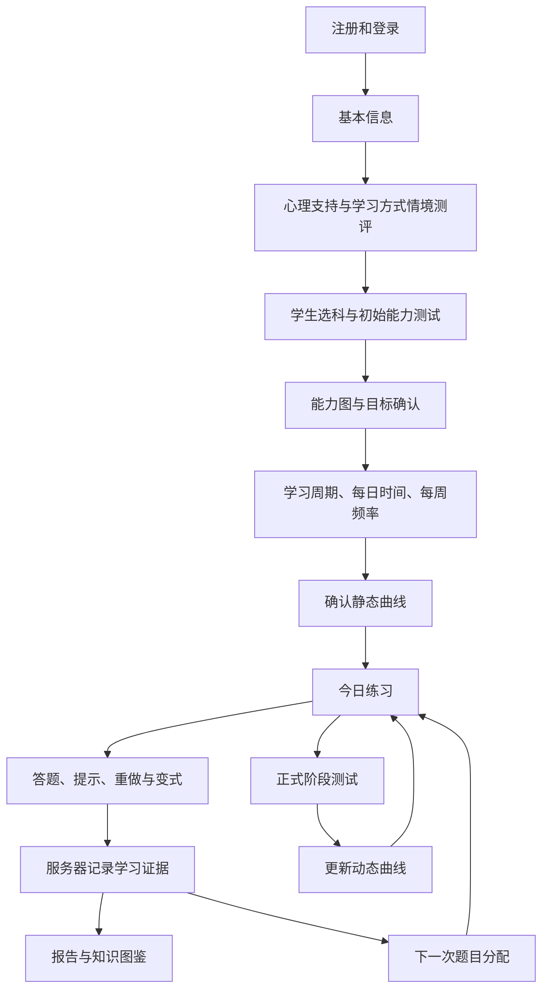
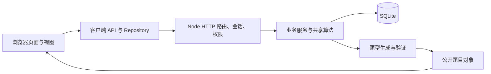

# 项目理解与开发接手手册

核对日期：2026-09-14。对应本地 `Semi AI` 交付目录，版本 1.0.0。

这份手册把产品含义、实际代码、验证结果和下一步开发连接起来。结论来自当前交付文档、核心代码阅读与本机测试；没有将商业预测、外部研究或教育效果主张作为本轮已验证事实。

## 1. 先理解它解决什么问题

这是一个以数学练习为中心的个性化学习系统。它希望回答三个问题：学生从哪里开始、接下来练什么、卡住时怎样帮助。

产品用九个字概括：**一对一、练中学、帮你学**。

| 产品原则 | 具体行为 | 程序中的含义 |
| --- | --- | --- |
| 一对一 | 不同学生有不同起点、目标、节奏和题目组合 | 测评、学习计划、行为证据、每日分配引擎共同决策 |
| 练中学 | 答错以后重做，再做受控变式，检验能否独立完成 | 服务器维护练习状态机和推进条件 |
| 帮你学 | 逐层提示、分步引导、历史原题回忆、多种解法 | 帮助内容源于题型解题结构，并记录使用证据 |

学生是完整流程的主体。家长和老师是通过关系授权参与的观察者、建议者，不是学生开始学习的必要审批环节。

当前主要范围是上海风格 G1–G6 数学。实际数据中有 **41 个题型族、8 个领域**，尚未构成逐章教研认证的完整课程。这里的“41”指生成题目的模型数量，不是静态题目数量，也不是已覆盖教材章节数量。

## 2. 沿着一个学生的经历理解全部流程



首次进入时，系统应恢复该学生自己的入学进度。基本信息、两层情境测评、主动选科、无提示能力测试、目标和节奏确认都有各自的数据与前置条件。

情境测评用来形成支持策略的起点，例如帮助入口、反馈方式和任务分块。它不是医学诊断，也不应成为向学生展示的固定“性格标签”。

日常使用时，学生主导航是“首页 / 测试 / 练习 / 报告”。任务已经包含在练习流程里；知识图鉴是从相关页面进入的辅助视图。

可以用一个示意题理解练习闭环：原有 38 本书，增加后有 65 本，问增加多少本。学生答错后先重做；使用提示答对只证明能在支持下完成。系统还要看他是否能独立完成原题及换数字的题。换情境又是更高一层的迁移证据。**提示后答对、独立答对、数字变式成功和情境迁移成功，不能混成同一种掌握证据。** 示例是原理说明，不是本轮测试的逐题转录。

## 3. 最容易混淆的六组概念

| 概念 | 应怎样理解 |
| --- | --- |
| 半 AI 与实时大模型 | 目前运行的是人工定义题型边界、程序生成和校验的自适应系统，没有生产大模型接入 |
| 题型族与一道题 | 题型族定义关系、变量、年级、标签等；输入种子和变式后生成一道具体题 |
| 学习计划与今日运行 | 计划决定目标和节奏；今日运行保存正在做哪个单元、哪种变式、下一步是什么 |
| 日常适应与动态曲线 | 练习证据改变下一次题目组合；符合条件的正式测试才更新动态曲线 |
| 知识覆盖与正式达到水平 | 图鉴点亮体现已有证据；达到某年级需要另外的覆盖与正式测试判定 |
| 浏览器状态与可信事实 | 浏览器负责界面和缓存；身份、评分、推进、正式测试结果以服务器数据为准 |

静态曲线目前是“起点、目标、学习时间、预设基线”组合出的估算。`learning-curve-engine.js` 中存在默认增益、时间换算和权重；`dynamic-learning-curve-engine.js` 以正式测评与计划的差异重估后续曲线。它们可解释、可回归，但不等于经过真实学生纵向数据校准的预测模型。

## 4. 系统到底如何运行

技术栈很轻：原生 HTML/CSS/JavaScript ES modules、Node.js 标准库 HTTP 服务、内置 `node:sqlite`。没有 React/Vue、Express，也没有第三方运行时依赖或必需的前端构建步骤。



“前后台职责分离”不代表两个独立服务器。本地是一个 Node 进程，同时提供静态页面和 `/api`。

| 入口或目录 | 实际职责 | 阅读提醒 |
| --- | --- | --- |
| `server/dev-server.mjs` | 创建数据库、HTTP server，监听 127.0.0.1 | 服务启动第一站 |
| `server/local-api-server.mjs` | 鉴权、权限、API 编排、题目交付、静态文件 | 当前约 177 KB，业务集中度较高 |
| `server/database.mjs` | 表结构、SQLite 读写、账号、会话和种子数据 | 多数业务对象保存为 JSON |
| `src/student-app-bootstrap.js` | 确认会话与身份，选择学生端或观察端 | 排查登录跳转和身份串用先看这里 |
| `src/app.js` | 学生端编排、数据恢复、事件绑定、多个业务流程 | 当前约 178 KB，适合按函数追踪而非从头背代码 |
| `src/core/` | 基础 DOM、格式化、状态、视图路由 | `view-router.js` 切换 DOM 视图，不是完整路由框架 |
| `src/modules/` | 练习、测试、报告、图鉴等视图及部分历史逻辑 | 不要仅凭目录名判断执行位置 |
| `src/services/` | 客户端仓库、共享计算、题目引擎与证据规则 | **不是全都只在浏览器执行**，服务器也导入这里的引擎 |
| `src/data/` | 题型、图谱、课程标签、配置和演示数据 | 区分课程元数据、预设统计值和 mock 数据 |
| `src/observer-app.js` | 家长和老师工作台 | 配合 `observer-dashboard.js` 和报告服务读 |
| `server/*-contract.mjs` | 可独立执行的业务与边界回归 | 96 个测试脚本，不是只有 96 条断言 |
| `reference/` | 早期设计与决策参考 | 有旧路径和旧阶段描述，不能直接当当前开发待办 |

页面入口包括 `signin.html`、`index.html`、`observer.html`、`account.html`、`student-management.html`。`demo.html` 和 `development-status.html` 用于内部演示、审阅。

## 5. 跟踪一条真实代码链：今天的一道题

1. **学生入口确认身份。** `student-app-bootstrap.js` 读取会话，准备当前学生身份，再加载 `app.js`。
2. **恢复状态并检查入学与测评门槛。** 浏览器通过 `local-api-client.js` 请求服务器；服务器检查登录角色和学生关系，不能只信请求里的 studentId。
3. **取得当天唯一计划。** API 从已确认静态或有效动态曲线、当前教学年级、近期证据和测试节奏推导计划。
4. **决定题目组合。** `daily-allocation-engine.js` 算各类任务比例；`daily-question-queue-engine.js` 再选择具体题型与队列。
5. **创建或恢复练习运行。** `daily-practice-run-service.mjs` 管理单元、变式阶段、独立重做和可选加练。
6. **生成候选并验证。** `question-source.js` → `math-item-generator.js` → 答案、语义、情境、推导等验证器。
7. **保存私有交付，返回公开对象。** `question-delivery-runtime.js` 的 `createQuestionDeliveryRecord` 和 `toQuestionDeliveryPresentation` 区分私有候选与公开展示。
8. **提交作答并由服务器判分。** `recordQuestionDeliveryAttempt` 标准化答案并与私有答案匹配，记录时间、提示深度、尝试次数，驱动运行状态推进。
9. **聚合证据。** 交付记录与可信行为进入数据库，报告、知识图谱和下一次分配分别读取自己的证据口径。

重要对象关系：

```text
studentId + subjectId
  └─ student_plans：目标、静态/动态曲线和节奏
      └─ practiceDate
          ├─ daily_practice_plans：今天怎样分配
          └─ daily_practice_runs：今天执行到哪里
              └─ question_deliveries：实际交付的具体题和尝试
                  └─ behavior_events：后续分析使用的事件
```

如果“刷新后换题”“同一天重复创建任务”“提示后被算作独立掌握”出现异常，应沿这条链检查，不能只改页面显示。

## 6. 个性化分配具体做了什么

`daily-allocation-engine.js` 的默认比例是：错题重做 40%、正确题复核 25%、当前阶段新题 25%、挑战扩展 10%。这是规则起点，不是每个学生每天固定的最终出题比例。

引擎结合错误率、重做成功率、无提示正确率、变式稳定性、迁移证据、自愿练习、疲劳信号等调整，并设置证据量权重、比例上下界和相对前日的平滑约束。队列还需要处理实际可用题型、年级约束、已解决错误和图谱前置关系。

因此需要分开测试两件事：**分配权重是否合理，最终选出的题目是否符合真实证据与边界。** 一个百分比变化正确，不足以证明整条个性化链正确。

## 7. 题型库在哪里，怎样扩充

原交付索引将 `src/modules/math-question-logic.js` 称为题型定义入口；更准确地说，该文件建立索引和交付合同，**41 个题型族的声明在 `src/data/shanghai-math-taxonomy.js`**。

| 文件 | 对新增题型的作用 |
| --- | --- |
| `src/data/shanghai-math-taxonomy.js` | family id、年级、领域、前置、变量、变式、能力标签与图鉴节点 |
| `src/data/math-knowledge-graph.js` | 知识图谱和前置关系 |
| `src/services/math-item-model-specification.js` | 可执行题型规格与边界 |
| `src/services/math-item-generator.js` | 按模型生成题面、答案、步骤、提示和标签 |
| `src/services/math-answer-rule-evaluator.js` | 答案规则重算 |
| `src/services/math-family-semantic-validator.js` | 题型关系与题面语义校验 |
| `src/services/math-application-context-validator.js` | 情境一致性校验 |
| `src/services/math-solution-derivation.js` | 可验证推导 |
| `src/services/math-solution-strategy-engine.js` | 解法结构 |

扩充一个题型的完整单位，应包含：课程位置 → 数据声明 → 变量边界 → 生成器实现 → 答案与语义验证 → 提示和步骤 → 独立重做及变式规则 → 图谱与报告证据 → 回归与教研审核。

目前生成器约 240 KB，是最明显的集中模块之一。适合在后续改动某一题型时逐步抽取该题型实现，并用已有合同保护行为。

## 8. 数据、身份和三角色报告

数据库定义了 18 张表。账号、会话、关系等使用结构化字段；计划、测试、题目运行等大量使用 `record_json` 等 JSON 字段。这让 MVP 演进方便，但后续跨对象查询、版本迁移、统计和索引需要单独设计。

| 数据类别 | 主要表 | 谁决定事实 |
| --- | --- | --- |
| 身份与访问 | user_accounts、auth_sessions、student_access_links、student_relationship_invites | 服务器会话和有效关系 |
| 基础与入学 | student_profiles、student_onboarding_prefills、assessment_sessions | 学生确认与服务器测评 |
| 目标和计划 | student_learning_goal_drafts、student_plans | 有权限的建议及学生确认，服务器生成计划 |
| 每日练习 | daily_practice_plans、daily_practice_runs、daily_practice_sessions | 服务器计划与运行 |
| 具体作答 | question_deliveries、behavior_events | 服务器判分与有来源边界的事件 |
| 协作与设置 | student_messages、student_preferences、observer_workspaces | 各角色被授权的操作 |
| 账号审计 | account_audit_events | 服务器记录 |

密码使用 scrypt 派生哈希，会话 token 存哈希。当前 cookie 为 HttpOnly、SameSite=Lax，本地服务只监听 127.0.0.1。

报告主要从 `server/learning-report-service.mjs` 开始追踪。学生看到学习反馈与下一步，家长看到节奏和支持建议，老师看到更细的题型与干预证据。三端应共享事实来源，但不共享全部展示字段。增加报告字段时，要同时验证字段来源、样本不足时的表现和角色可见性。

## 9. “全 AI ready”现在到底有多 ready

已经有 `question-source.js` 候选适配边界，支持传入 provider 与候选，再执行验证、来源标记和规范候选绑定。

但是当前 full_ai_ready 路径要求 provider 身份，并且候选要和规则生成的 canonical 参考匹配。没有 provider 时会返回 `ai_candidate_provider_required`。因此开关名称不意味着切换以后就有实时模型，更不意味着已经允许自由生成新题型。

未来接模型时，需要在这条服务端边界内定义候选协议、评测集、失败处理与发布策略。不能让模型返回的“正确答案”“已掌握”直接成为学习事实。现有代码中的严格拒绝，也不能等同于已经完成生产熔断与自动降级。

## 10. 本轮接手验证结果

| 检查 | 结果 | 证据或限制 |
| --- | --- | --- |
| 交付文件完整性 | 293 个清单文件全部匹配 | 原 MANIFEST.sha256；不覆盖本轮新增开发文件 |
| 本机 Node | v24.19.0 | 满足 package.json 的 Node >=24 |
| 依赖安装 | 不需要 | package.json 无第三方依赖；当前命令环境没有 npm，不影响运行 |
| 96 个合同脚本 | 96 passed，0 failed | runtime-data/review-contracts-20260914.log |
| 五人端到端 API 流程 | passed | runtime-data/review-e2e-20260914-reports/system-e2e-journey-mu1g6arw.md |
| 持久化重启 | passed | 上述 E2E 包含 SQLite 关闭重开验证 |
| 本地服务 | 首页 200，health 返回 ok | 127.0.0.1:4177，快照工作副本 |
| 题型数量 | 41 族、8 领域 | 实际导入 taxonomy 统计 |
| 浏览器视觉与交互复核 | 本轮未完成 | 内置浏览器 webview 连接超时，没有有效页面观察 |
| Git 历史 | 不存在 | 当前解压目录不是 Git repository |

原 Node 测试启动器通过 spawnSync 再启动 Node，本工具环境返回 EPERM，且原启动器没有输出 error 字段，表面上仅显示首项失败。本轮由 PowerShell 顺序启动**相同的 96 个原始脚本**后全部通过。这是执行环境与启动器诊断问题，不能据此说账号安全合同存在断言失败。

E2E 实际创建 5 学生、5 家长和 1 老师，执行关系邀请、入学、三天练习、阶段测试、三角色报告、匿名参照、100 次身份确认/切换与数据库重开。它主要通过 HTTP API 执行，并利用测试端对题目的了解模拟作答，不替代真正浏览器点击、视觉检查或真实学生效果验证。测试随运行标识产生不同作答序列，不能把某次分数当固定黄金答案。

## 11. 接下来开发前，必须知道的实际问题

### 已核实的静态文件暴露边界

`server/local-api-server.mjs` 的 `serveStatic` 直接从整个 projectRoot 解析文件。未登录 HEAD 请求 `/server/database.mjs` 和 `/test-data/system-e2e-final.sqlite` 均返回 200。本轮只检查响应状态，没有导出数据库内容。

这说明 API 权限隔离不等于部署目录隔离。生产化的首个修复应是静态资源明确白名单或独立 public 目录，禁止 server、数据库、运行日志与内部材料被静态分发，并使用可靠路径包含判断。修复应保留合法页面及浏览器依赖模块加载，并补正反向回归。

### 文档漂移

- `reference/development-prep.md` 仍说后端可以 mocked，且把 Sprint 0 当下一步；当前已有真实后端，不应据此从头重做。
- 该文档的一些 `docs/...` 引用指向不存在的旧文档；部分对应材料已经位于 reference。
- `src/data/route-map.js` 的 entry-page-01…20 是历史流程映射；当前包未包含这些原型页。实际学生运行入口是 index.html + app.js。
- 题型族定义与题型索引文件需要按第 7 节区分。

### 运行环境细节

- `.env.example` 是变量说明，启动代码不会自动加载 `.env`；需在 PowerShell 设置环境变量，或使用本轮脚本。
- 原 Windows 文档里的 Copy-Item 命令每次执行可能覆盖已有工作副本。本轮启动脚本只在工作副本不存在时复制。
- “clean”表示另一个数据库文件，不表示绝对空库：database.mjs 启动时会植入林安等本地演示账号。也不表示每次启动清空之前的数据。
- 现有部分 subjectId 是 `math-linear-equations`，但对应的实际数学范围已经更广。新增学科或统一 ID 前，应梳理已有数据键和 API，不能只改显示名称。
- 生成功能、前端与后端代码有共享和演示分支；发布环境需要明确执行边界，不能直接把整个交付目录当静态网站上线。

### 工程能力仍待建设

当前没有 Git 历史、正式 OpenAPI、版本化数据库迁移和完整浏览器回归流水线。最重的编排文件也已较大。课程逐章覆盖、真实学习效果和生产部署能力均需各自验收，不能用 96 项合同通过替代。

## 12. Windows 开发入口

本轮新增 `scripts/dev.ps1`，统一启动、合同测试、五人测试和交付完整性检查；无需 npm。它在退出时恢复调用前的相关环境变量，不自动重置数据。

脚本已通过 PowerShell 语法解析，verify 核对 293 文件成功，test 实际执行 96 个合同全部通过，e2e 再次完成五名学生流程，start 使用独立初始库在 4178 启动并通过健康检查。4178 临时验证服务随后已停止。脚本回归日志为 `runtime-data/contracts-20260914-122447-422.log`，E2E 报告为 `runtime-data/e2e-reports-20260914-122522-096/system-e2e-journey-mu1gf1oo.md`。

在 PowerShell 中：

```powershell
Set-Location 'E:\AI Education\Semi AI'

# 核对交付基线；以后修改原文件时校验失败是预期的变更信号
.\scripts\dev.ps1 -Action verify

# 启动五人快照副本，默认 4177；Ctrl+C 停止
.\scripts\dev.ps1 -Action start

# 在另一个终端运行回归
.\scripts\dev.ps1 -Action test

# 新建时间戳数据库和报告，执行五人完整流程
.\scripts\dev.ps1 -Action e2e

# 独立的初始运行数据库，仍会包含内置演示账号
.\scripts\dev.ps1 -Action start -Mode clean -Port 4176
```

五人快照入口：http://127.0.0.1:4177/ 。学生 `journey-mtsalc9v.student1`，家长 `journey-mtsalc9v.parent1`，老师 `journey-mtsalc9v.teacher`；本地虚构测试共同密码见原 `docs/04_运行部署与测试账号.md`。

运行副本、日志与新增 E2E 均位于 runtime-data。原 test-data 快照、交付 zip 与原测试报告作为基准保留。旧 MANIFEST 用于核对原交付；正式开发发布时应另建版本和清单。

## 13. 按这个顺序学，就能把产品和代码连接起来

### 第一遍：理解产品

读 docs/01、02，再沿页面走“学生入学 → 今日练习 → 报告 → 成人观察”。每经过一步，回答：它输入什么、输出什么、为什么下一步需要它。浏览器检查仍需补做。

### 第二遍：掌握一条主链

按第 5 节阅读启动、身份、API、每日计划、运行、题目交付和事件记录。只追踪“今天一道题”，避免同时阅读几十个 engine。

### 第三遍：看懂决策算法

依次读 learning-curve-engine、daily-allocation-engine、daily-question-queue-engine、daily-practice-run-service、dynamic-learning-curve-engine。重点找输入、输出和禁止条件，先不纠结每个常量。

### 第四遍：理解证据和展示

读 question-delivery-runtime、behavior-evidence-window、behavior-analysis-engine、family-mastery-estimator、level-attainment-engine、learning-report-service，搞清楚不同证据能支持多强的结论。

### 第五遍：通过一次小改动练习开发

优先选择“静态资源访问边界修复”作为工程任务，或“一个已有题型的边界完善”作为内容任务。先找到相关合同并复现现状，再改实现、验证正反例、跑全套合同，影响学习主链时加 E2E。

## 14. 后续开发任务如何定位

| 要做的改动 | 第一组文件 | 必须保留的边界 |
| --- | --- | --- |
| 登录、账号或关系 | bootstrap、auth-client、local-api-server、database | 当前会话决定身份；成人只能看有效关联学生 |
| 入学流程 | onboarding 模块、onboarding-status-service、initial-learning-plan-service | 前置顺序和学生确认，测试无提示 |
| 更合理地安排下一次练习 | daily-allocation、daily-question-queue、behavior-evidence-window | 来源可信、证据量、年级、平滑与唯一日计划 |
| 重做或挑战流程 | daily-practice-run-service、retry/variant/challenge evidence policies | 有帮助完成不能直接当独立掌握 |
| 新数学题型 | taxonomy、generator、specification、各验证器 | 答案可重算、题意一致、变式边界和元数据完整 |
| 调整学习曲线 | learning-curve、stage-assessment、dynamic-learning-curve | 只有合格正式测试更新动态曲线 |
| 报告、图鉴 | learning-report-service、knowledge-graph/atlas services、对应 view | 区分覆盖、掌握、正式达标与角色可见性 |
| 接入模型候选 | question-source 与服务端 provider | 候选必须验证；当前 canonical 绑定不能悄悄放宽 |
| 发布到服务器 | dev-server、静态文件边界、会话配置、数据库和迁移 | 私有文件隔离、本地种子数据隔离、运行可恢复 |

开发完成的实际判断应是：行为符合产品规则、数据有明确所有者、错误路径可解释、相关合同通过、下游能用新数据、必要时 E2E 和浏览器检查通过，并更新本手册或对应接口说明。

## 15. 自检：能回答这些问题，就理解了主干

1. 为什么学生用了提示后答对，系统还要求独立完成？
2. 为什么练习正确率上升可以改变出题，却不能直接改动态曲线？
3. 题型族、候选题、题目交付、练习运行分别保存什么？
4. 家长换一个 studentId 发请求，服务器在哪层拒绝？
5. 为什么只在前端隐藏答案或画像字段还不够？
6. 为什么图鉴点亮不等于正式达到某个年级？
7. 为什么 full_ai_ready 开关不等于已经接入大模型？
8. 新增一个题型，除了题面和答案，还要增加哪些内容？
9. 为什么不能把整个项目目录直接作为生产静态目录？
10. 如何用同一测试基线判断下一次改动是否破坏学习闭环？

答案依次可在第 2/3、3/6、5、5/8、5/11、3/8、9、7、11、10/12/14 节找到。
